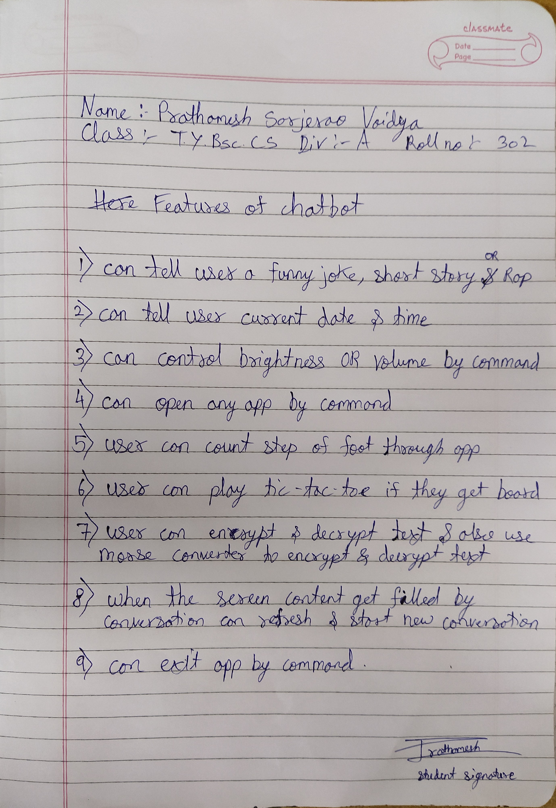

# Super Chatbot

An Android chatbot application built in **Java and XML** as my B.Sc. Computer Science **Semester V** project (2022). It combines a conversational chatbot with a set of built-in utility tools that are opened through slash commands.

> This is an early academic project, kept here as part of my learning record.

## How It Works

- Messages are sent to the **BrainShop** chatbot API using the **Volley** HTTP library; the JSON reply is parsed and shown in a chat view (`RecyclerView`).
- Messages that start with `/` are handled locally and open one of the utility features below.

> **Note:** The BrainShop API this app depended on may no longer be available, so the chat replies may not work today. The local utility features do not depend on it.

## Commands

| Command | Feature |
|---|---|
| `/ShowDateandTime` | Display the current date and time |
| `/Brightness` or `/Open BrightnessSettings1` | Control screen brightness |
| `/Open control_volume` | Control volume |
| `/Open StepCount` | Step counter (uses the device motion sensor) |
| `/Open tic_tac_toe` | Play tic-tac-toe |
| `/Open caeser_cipher` | Caesar cipher encoder/decoder |
| `/Open morse_code` | Morse code translator |
| `/Refresh Content` (or swipe down) | Refresh the chat |
| `/Exit` | Exit the app |



## Running the Project

- **Try the app:** install [`Super Chatbot.apk`](Super%20Chatbot.apk) on an Android device (Android 5.0 / API 21 or later).
- **Build from source:** open the `SuperChatbot/` folder in Android Studio and run it on an emulator or device.

## Repository Contents

| Path | Description |
|---|---|
| `SuperChatbot/` | Android Studio project (Java source in `app/src/main/java/com/example/superchatbot/`) |
| `Super Chatbot.apk` | Installable build of the app |
| `My Black Book.pdf` | Project report (black book) |
| `Presentation on Chatbot.ppt` | Project presentation |
| `Brainshop training.docx` | Notes on training the BrainShop bot |
| `Chatbot Features.txt` | Command list |
| `Plagiarism - Report.doc` | Plagiarism check of the project report |

## Citation

If you use or build on this project, please cite it. GitHub's **"Cite this repository"** button (generated from [`CITATION.cff`](CITATION.cff)) provides APA and BibTeX formats.

```bibtex
@software{vaidya_superchatbotproject_2022,
  author = {Vaidya, Prathamesh Sarjerao},
  title  = {Super Chatbot: Android Chatbot with Utility Commands},
  year   = {2022},
  url    = {https://github.com/Prathameshv07/Super-Chatbot_Project}
}
```

## License

[](https://creativecommons.org/licenses/by-nc/4.0/)

© 2022 Prathamesh Sarjerao Vaidya. This work is licensed under the [Creative Commons Attribution-NonCommercial 4.0 International License](https://creativecommons.org/licenses/by-nc/4.0/). You may share and adapt it for **non-commercial** purposes, provided you **give appropriate credit** and indicate any changes. See [LICENSE](LICENSE) for details.
